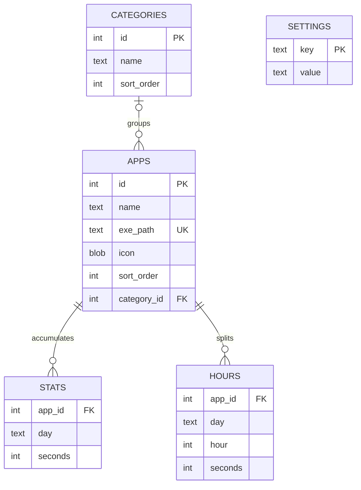

# Архитектура Nodexy: разбор для сопровождения

> Снимок архитектуры по исходникам на 2026-10-11. Это локальное Windows-приложение: PySide6-интерфейс, логика учёта и SQLite работают в одном процессе; отдельного сервера или HTTP API в проекте нет.

**Отдельная карта связей:** [SVG для увеличения и редактирования](architecture-map.svg) · [PNG-превью](architecture-map.png).

## Короткая модель приложения

```text
Windows (активное окно, простой, список процессов)
                    ↓
         app/tracker.py — правило учёта
                    ↓  буфер секунд по приложению/дню/часу
              app/db.py — SQLite
                    ↓
   app/ui/main_window.py — карточки и главный экран
                    ↓
 app/ui/stats_panel.py + app/ui/widgets.py — графики
```

`main.py` связывает эти части при запуске. `MainWindow` — координатор пользовательских сценариев; `Tracker` независимо отрисовки решает, кому засчитать время, и сообщает главному окну о каждом тике.

## Что происходит при запуске и во время учёта

1. **Запуск.** `main.py` ставит блокировку `QLockFile`, чтобы не открыть вторую копию. Создаёт `QApplication`, применяет тему, затем ищет путь к базе в конфиге. Если база отсутствует или не проходит минимальную проверку, показывает `WelcomeDialog` — создать базу или выбрать существующий `.db`.
2. **Подготовка данных.** `Database` открывает SQLite, включает внешние ключи и WAL, создаёт таблицы и выполняет миграцию `category_id`. `main.py` фиксирует `first_launch`, а для сегодняшнего дня дополняет отсутствующую почасовую статистику, если есть дневной итог без часов.
3. **Связывание объектов.** Создаются `Tracker(db)` и `MainWindow(db, tracker)`. Главное окно загружает приложения из БД и передаёт трекеру соответствие `нормализованный путь exe → app_id`. Затем запускается таймер трекера.
4. **Тик раз в секунду.** `Tracker` вызывает функции `win32_utils`: читает время бездействия, процесс активного окна и, при включённом фоновом учёте, множество запущенных процессов. Сопоставляет пути только с приложениями, добавленными пользователем.
5. **Решение об учёте.** В обычном режиме засчитывается отслеживаемое приложение на переднем плане. При фоновом учёте к нему добавляются все отслеживаемые приложения, которые сейчас запущены. Секунды нарезаются по локальным границам часа и дня и сначала попадают в буфер трекера.
6. **Сохранение и экран.** Буфер записывается пачкой примерно раз в 15 секунд, а также при остановке трекера, смене даты, обновлении списка и перед экспортом/переключением базы. Сигнал `Tracker.tick` вызывает `MainWindow._on_tick()`: окно объединяет сохранённые секунды с ещё не сброшенным буфером и обновляет карточки, графики и строку состояния.
7. **Выход.** Если доступен системный трей, закрытие окна его скрывает, но учёт продолжается. Команда «Выход» завершает Qt-приложение; `aboutToQuit` останавливает таймер и сбрасывает остаток буфера.

### Правило простоя — важная деталь

- Порог по умолчанию — **30 минут**, настраивается в пределах 1–240 минут. Отдельная «льготная» граница — `GRACE_SECONDS = 5` в `app/tracker.py`.
- Когда системный простой превышает 5 секунд, трекер запоминает набор приложений и начало простоя. Если пользователь вернулся до превышения настроенного порога, этот интервал засчитывается задним числом; если простой оказался длиннее порога, весь сохранённый интервал простоя не засчитывается.
- Список работающих процессов кэшируется на 2 секунды. В фоновом режиме одновременно могут учитываться несколько добавленных приложений; поэтому сумма по приложениям за период может быть больше реального времени на часах.
- Буфер хранит дробные секунды, а при записи в БД целые секунды; дробный остаток сохраняется до следующего сброса.

## Основные пользовательские сценарии

### Добавить приложение

`MainWindow._open_add()` → `AddPanel` → фоновое сканирование через `_ScanWorker` → `installed_apps.get_installed_apps()` → `add_requested` → `MainWindow._on_add_request()` → извлечение PNG-иконки через `win32_utils` → `Database.add_app()` → `refresh_apps()`.

Источники списка: разделы деинсталляции реестра Windows, ярлыки меню «Пуск», манифесты библиотек Steam и подходящие запущенные процессы. Результаты объединяются по нормализованному пути `.exe`. Иконки в списке диалога извлекаются в задачах `QThreadPool`; выбрать `.exe` можно и вручную.

### Изменить настройки

`SettingsPanel` только собирает значения и отправляет сигнал. `MainWindow._apply_settings()` передаёт порог и фоновый режим трекеру; трекер сохраняет их в `settings` базы. Показ подсказки графика хранится там же под ключом `show_chart_help`.

### Посмотреть статистику

Клик по карточке открывает `StatsPanel`. Он берёт историю из `stats`, сегодняшний live-итог — из БД плюс не сброшенный буфер трекера, затем строит выбранный ряд. Фиксированные периоды — день/неделя/месяц/год; «Всё время» использует `TimelineData` и динамический зум от месяцев/недель до дней/часов. Само рисование и мышиные жесты реализованы в `RangeChart` из `widgets.py`.

### Экспортировать или переключить базу

Экспорт сначала сбрасывает буфер трекера, затем `Database.export_to()` создаёт согласованную копию SQLite через `VACUUM INTO`. При переключении трекер сначала сбрасывает старую базу, открывается новая, обновляется путь в `config.json`, после чего перерисовывается список. Валидация выбранной базы проверяет наличие основных таблиц и колонок; при открытии новая схема доводится миграциями.

## Файлы и зоны ответственности

| Файл | За что отвечает | Где искать при изменении… |
|---|---|---|
| [`main.py`](../main.py) | Точка входа, блокировка второго запуска, выбор БД, первичная подготовка, создание и остановка объектов | Порядка запуска / инициализации |
| [`app/config.py`](../app/config.py) | `%APPDATA%\\ActiveTracker`, `config.json`, путь к БД, `crash.log` | Пути и настройки уровня приложения |
| [`app/db.py`](../app/db.py) | Схема SQLite, миграции, чтение/запись приложений, категорий, времени и настроек; экспорт/валидация | Любого нового сохраняемого поля, таблицы или запроса |
| [`app/tracker.py`](../app/tracker.py) | Секундный цикл, выбор приложений, простой, фоновый режим, буфер и сброс статистики | Правила «кому и когда засчитывать» |
| [`app/win32_utils.py`](../app/win32_utils.py) | Win32 API: idle time, foreground PID/exe, процессы, описание файла и PNG-иконки | Низкоуровневой Windows-интеграции |
| [`app/installed_apps.py`](../app/installed_apps.py) | Поиск приложений через реестр, Start Menu, Steam и работающие процессы; фильтрация и дедупликация | Источников и правил сканирования |
| [`app/ui/main_window.py`](../app/ui/main_window.py) | Главный экран, карточки, категории, поиск, периоды, меню, трей, экспорт/переключение БД и обновление UI | Пользовательских сценариев и сводных цифр карточек |
| [`app/ui/add_dialog.py`](../app/ui/add_dialog.py) | Диалог добавления, фоновое сканирование, поиск и загрузка иконок | UX добавления приложения |
| [`app/ui/settings_dialog.py`](../app/ui/settings_dialog.py) | Форма настроек и сигнал `saved` | Полей настроек (их сохранение также меняется в `MainWindow`/`Tracker`) |
| [`app/ui/stats_panel.py`](../app/ui/stats_panel.py) | Детальная статистика, календарные периоды и `TimelineData` | Агрегации и навигации по истории |
| [`app/ui/widgets.py`](../app/ui/widgets.py) | `AppCard`, `MiniChart`, `RangeChart`, `SidebarItem`, `CategoryHeader`, переключатель и пользовательская отрисовка | Внешнего вида графиков/карточек и жестов мыши |
| [`app/ui/modal.py`](../app/ui/modal.py) | Затемнение окна, показ/закрытие модальной панели и анимация | Общего поведения модальных окон |
| [`app/ui/welcome_dialog.py`](../app/ui/welcome_dialog.py) | Выбор базы при первом запуске | Первичного сценария выбора БД |
| [`app/ui/theme.py`](../app/ui/theme.py) | QSS, цвета и иконка Nodexy | Тёмной темы и брендинга |
| [`app/utils.py`](../app/utils.py) | Русские подписи дат, периоды календаря и форматирование секунд | Общих подписей дат/времени |

`assets/` содержит иконки приложения. `requirements.txt` фиксирует runtime-зависимости. `build_exe.bat` собирает Windows exe через PyInstaller. `rezult/smoke_charts.py` — отдельная offscreen-проверка графических компонентов, а не полноценный набор тестов.

## Как хранятся данные

По умолчанию файлы лежат в `%APPDATA%\\ActiveTracker` (если `APPDATA` недоступна — в домашней папке пользователя). Путь к `.db` можно сменить в приложении.

- `config.json` — путь активной базы (`db_path`) и дата начала установки (`first_launch`).
- `tracker.db` — локальная SQLite-база по умолчанию; настройки учёта тоже живут в ней, а не в JSON.
- `crash.log` — исключения и диагностические сообщения.

Основные таблицы и связи:



`stats` — дневной итог по паре `(app_id, day)`. `hours` — его почасовая разбивка по `(app_id, day, hour)` для графиков. `settings` — строковые ключ/значение (`idle_threshold_minutes`, `background_counting`, `show_chart_help`). Удаление приложения каскадно удаляет связанную статистику и часы; категория у приложения необязательна.

## Куда идти с изменением

| Нужно… | Начать здесь | Не забыть |
|---|---|---|
| Изменить idle/background-правило | `app/tracker.py` | Проверить статус в `MainWindow._update_status()` и подписи в настройках |
| Добавить новый переключатель | `settings_dialog.py` | Протянуть значение через `MainWindow._apply_settings()`; сохранить/прочитать в БД или трекере |
| Добавить поле или таблицу | `app/db.py` | Написать идемпотентную миграцию; проверить чтение старого `.db` на копии |
| Изменить обнаружение приложений | `installed_apps.py` | Проверить фильтры, дедупликацию и ручной выбор в `add_dialog.py` |
| Изменить суммарное время на карточке | `main_window.py` | Сверить live-буфер, текущий день и пять периодов |
| Изменить детальный график | `stats_panel.py`, затем `widgets.py` | Проверить day/week/month/year/all, зум, выделение и пустую историю |
| Изменить системный API или иконки | `win32_utils.py` | Проверять на Windows; модуль напрямую использует Win32/pywin32 |
| Изменить визуальный стиль | `theme.py`, `widgets.py` | QSS может зависеть от `objectName`/свойств Qt-виджетов |

Практичное правило: **сначала сохранять единую трактовку секунд**. При изменении учёта проверьте одновременно буфер трекера, дневные `stats`, почасовые `hours`, карточки и подробный график. Для новой настройки проведите значение по всей цепочке «форма → слот MainWindow → объект логики → `settings` БД».

## Замечания, найденные при разборе

1. **Выделение диапазона в режиме «Всё время» выглядит недоведённым.** `StatsPanel._on_range_selection()` суммирует `self._chart._days`, однако `RangeChart.set_timeline()` в этом режиме держит ряд в `TimelineData`, а `_days` остаётся пустым. Поэтому итог выбранного диапазона может показываться как ноль; при глубоком зуме таймлайн также хранит границы в долях дня, а сводка сейчас форматируется как диапазон дней. Общий итог за «Всё время» рассчитывается отдельно. Это наблюдение, а не изменение поведения в рамках документации.
2. **Почасовая история старых/импортированных баз может быть приблизительной.** Если у дня есть сумма в `stats`, но нет строк `hours`, при глубоком зуме `TimelineData` распределяет сумму равномерно по 24 часам. Это fallback для показа, не восстановленная фактическая активность по часам. Для сегодняшнего дня `main.py` отдельно дополняет отсутствующие часы при запуске.
3. **Большие UI-модули.** `main_window.py` одновременно координирует сценарии, хранит часть агрегаций и управляет drag-and-drop/категориями; `widgets.py` содержит несколько кастомных виджетов и много кода отрисовки. При дальнейшем развитии их можно делить постепенно, сохраняя текущие сигналы и источники данных.
4. **Платформа.** `installed_apps.py` импортирует `winreg`, а `win32_utils.py` обращается к `ctypes.windll`; это Windows-приложение, не переносимый Linux/macOS GUI.
5. **Проверки.** В репозитории есть `rezult/smoke_charts.py`, но отдельного pytest-набора/CI-конфигурации не видно. Полный запуск и проверку интеграции следует делать на Windows с зависимостями из `requirements.txt`.

## Сборка и локальный запуск

- Исходники: `python main.py` (после установки `requirements.txt` на Windows).
- Сборка: `build_exe.bat` — ожидает `.venv` и установленный PyInstaller.
- `run.bat` запускает `pythonw.exe` из `.venv`.
- **Осторожно:** `publish.bat` жёстко адресует `main`; перед использованием проверьте его команды и целевую ветку.
